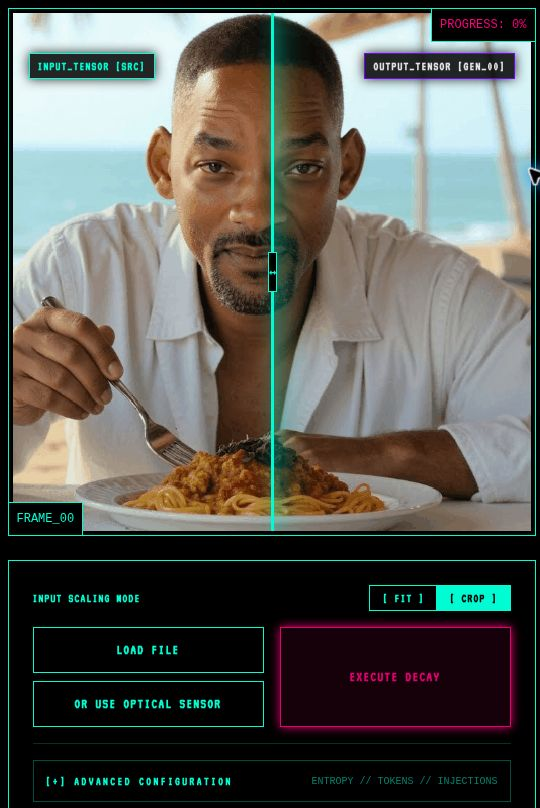
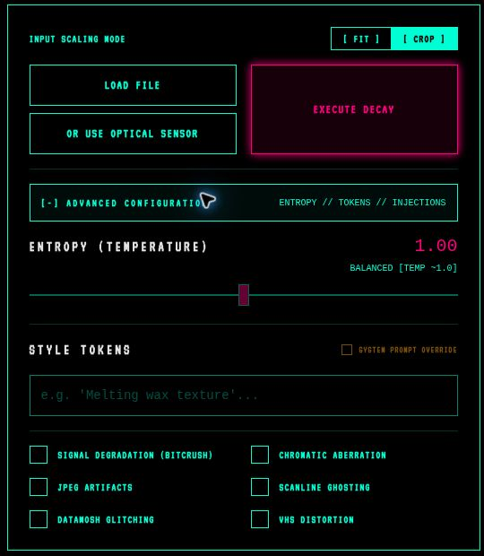
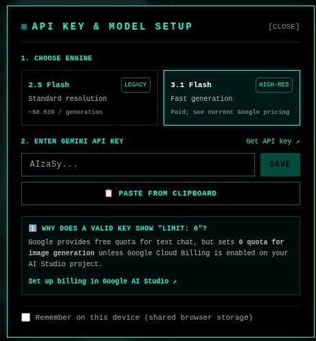

# Digital Decay

**What happens when AI keeps recreating its own last image?**

Start with an image, ask Gemini to recreate it, then feed the result back in. Do that again. And again. Digital Decay follows that process for up to 69 generations, letting you compare the changes and export the journey.

I was interested in what survives the repetition: which shapes stay recognizable, what gets exaggerated, and how far the image can drift while still feeling related to its source.

[Open the app](https://whatifqu3stion.github.io/digital-decay/) · [Install and run Digital Decay](#install-and-run-digital-decay) · [Key handling](docs/security-review.md)

## An example


*The broad composition survives while realistic textures become outlines and patterns.*

<p align="center">
  
  <br><em>The source followed by 69 generations, each using the previous image as its starting point.</em>
</p>

The idea echoes Alvin Lucier's [*I am sitting in a room*](https://www.moma.org/explore/inside_out/2015/01/20/collecting-alvin-luciers-i-am-sitting-in-a-room/), where recorded speech is repeatedly played and recorded in the same room. Here the feedback passes through an image model instead of room acoustics.

This is a creative experiment. “Decay” does not necessarily mean degradation: some results become more orderly or decorative. The images cannot tell us what is happening inside the model, and 69 is the app's limit, not a scientific threshold.

## Making the experiment approachable

The retro terminal gives it a playful identity, but the first task is straightforward: load an image and see what happens. More controls are available without making every visitor understand them first.

<table>
<tr>
<td align="center" valign="top" width="33%"><a href="docs/ux/workspace.jpg"></a></td>
<td align="center" valign="top" width="33%"><a href="docs/ux/controls.jpg"></a></td>
<td align="center" valign="top" width="33%"><a href="docs/ux/key-setup.jpg"></a></td>
</tr>
<tr>
<td valign="top"><strong>Start with the image.</strong> Fit or crop it, then use the comparison divider to keep the source in view.</td>
<td valign="top"><strong>Leave room to explore.</strong> Temperature, prompts, and effects live behind one expandable panel.</td>
<td valign="top"><strong>Explain the cost before the experiment.</strong> Model choice, billing guidance, and key storage belong together.</td>
</tr>
</table>

*Screenshots from the app. Select one to inspect it at full size.*

You can upload an image or use the camera, adjust the instructions, then generate. Pause to inspect a frame, scrub through the sequence, resume, and export a still, comparison, or GIF. The default instruction is deliberately small:

> Preserve the shapes and basic colors of the previous iteration.

## What the controls actually do

| Control | Behavior |
| --- | --- |
| **Entropy** | Changes model temperature and the prompt's emphasis on copying versus reinterpretation. It is a creative control, not a measured rate of decay. |
| **Bitcrush** | Reduces the starting image to 128 × 128 pixels before generation. |
| **VHS, JPEG, and other effects** | Adds those styles to the prompt. The model interprets them; no actual codec corruption is applied. |
| **Custom prompt** | Adds an instruction, or replaces the default directive when override is enabled. |

For a useful comparison, start separate runs from the same image and change one control at a time. Even with identical settings, results can vary.

## How the app is put together

**React and TypeScript** handle the interface, and **Google's GenAI SDK** handles image requests. Each generated frame becomes the next input; the original stays available for comparison rather than being reintroduced on every step.

Frames and session state live in **IndexedDB**, so inspecting the sequence does not require a hosted image store. Canvas and browser workers produce the exports. This keeps the app easy to host, but long runs and GIF exports use the visitor's storage, memory, and processing power. Browser data can also be cleared or evicted.

Progress, cooldowns, and error states matter when a run takes many requests. Temporary rate-limit errors have a retry path; billing and other failures can stop the sequence. The goal is to make the state understandable rather than leave someone wondering whether it is still working.

GitHub Pages sends requests directly from the browser to Google. Local development uses the included Express forwarding server. Both require the visitor's key; neither falls back to a host-funded key. [Generation code](services/geminiService.ts) · [Security review](docs/security-review.md).

## Try it in your browser

Open the [live app](https://whatifqu3stion.github.io/digital-decay/), connect your own Gemini key through the key dialog, and start with a short run. Check your Google project's model access, image quota, and billing first: a full sequence requests 69 new images, plus any retries. Images and prompts used for generation are sent to Google under its service terms.

Keys are saved for the tab session by default. **Remember on this device** optionally uses `localStorage`. Neither is an encrypted vault: same-origin JavaScript can read the stored key, other apps on the same GitHub Pages origin share that boundary, and the page loads third-party resources. Use **Disconnect Key** to clear the app's saved key. Never put one in a URL, screenshot, or commit.

## Install and run Digital Decay

You need Git, npm, and a Node.js version allowed by the [`engines` field](package.json). Node 24.22.1 or a later 24.x release satisfies the current requirement.

1. **Clone the project and open its folder.**

   ```bash
   git clone https://github.com/whatifqu3stion/digital-decay.git
   cd digital-decay
   ```

2. **Install dependencies.**

   ```bash
   npm ci
   ```

3. **Start the development server.**

   ```bash
   npm run dev
   ```

4. **Open `http://localhost:3000`.** Enter your Gemini key in the app, load an image, and begin a short run. No `.env` key is needed. Keep the development server private; it is not a hardened public deployment.

For development checks, run `npm run lint` for TypeScript checks, `npm test` for key-handling regression tests, and `npm run build` for the production bundle. A fork can deploy through **Settings → Pages → Source → GitHub Actions** without a Gemini repository secret.

## License

Code is [MIT licensed](LICENSE). That license does not grant rights to third-party likenesses or underlying material in the example images.
